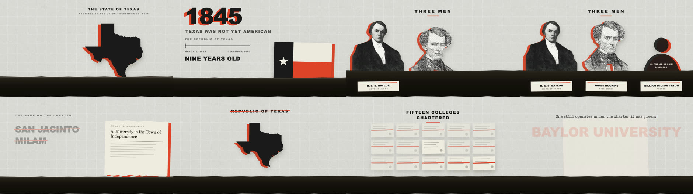

# vox-skill

A Claude Code skill that turns one researched topic into a finished narrated
film, built as React. Paper-texture collage, halftone cut-outs with an offset red
marker stroke, and charts, documents and newspapers drawn in code.

Horizontal 1920×1080 by default. Vertical 1080×1920 for TikTok, Reels and Shorts
when you ask.


*Full film: [`docs/baylor-founding.mp4`](docs/baylor-founding.mp4) · 65s*

## The idea it is built on

**The narration is the clock.** The voiceover is generated before any animation
exists, and every scene length and every animation cue is derived from its
word-level boundaries. A portrait rises when its owner's name is spoken because
the cue says `{"beat": 6, "word": "Robert", "offset": -34}`, not because someone
typed frame 65.

That one decision is what makes the film cheap to change. Swap the voice, the
rate, or a line of script and it re-times itself:

```bash
VOICE=en-US-ChristopherNeural python3 scripts/gen_vo.py
python3 scripts/sync_timing.py
npx remotion render src/index.ts MySequence out/film.mp4
```

Nothing is hand-tuned against a waveform, so nothing rots when the voice changes.

## What it produces



Everything in the example except three portraits is drawn in code: the state
outline from public-domain GeoJSON, the flag, the charter documents, the wax
seals, the fifteen-card grid, the rubber stamps, the timeline, the typewriter
close. Code-drawn beats sourced art on every axis — it animates natively, it
tunes instantly, and it never needs keying.

The portraits are public-domain scans, lifted with the macOS Vision framework and
screened into halftone locally. Where no public-domain likeness exists, the
subject is drawn as an ink bust rather than given a borrowed face.

## Audio

Narration is free via Edge neural TTS, then mastered: high-pass, a cut at 350 Hz
for the boxiness every neural TTS has, a presence lift at 3 kHz, de-essing,
compression and normalisation to −16 LUFS. That chain matters more than which
voice model you picked.

The music bed is synthesised, not licensed. A real documentary cue was measured
to find what the genre is spectrally, and `score.py` builds to that: a sectioned
arrangement with a motif that transposes with the harmony, a pulse that enters at
the midpoint, and a filter that opens across the build. It is then
sidechain-ducked under the narration.

One hard-won rule is baked into the tooling: **judge the bed by what a laptop
speaker reproduces, not by its spectrum plot.** Copying a reference cue's
"93% below 250 Hz" literally produces a bed that is silent on any speaker without
a woofer. The generator reports a small-speaker penalty and the audible level at
four points through the piece so a silent stretch surfaces before you render.

## Vertical

```bash
scripts/scaffold.sh ~/Desktop/my-film MyFilm --vertical
python3 scripts/captions.py     # sound-off is the default; burn them in
```

See [`references/vertical.md`](references/vertical.md) for the three dead zones
the platform draws its own interface over, why rows have to become stacks, and
why type goes *up* in a narrower frame.

## Thumbnails

Frame zero of a film built this way is an empty paper background — the worst
frame in the file, and the one every player picks by default.

```bash
python3 scripts/pick_thumbnail.py out/film.mp4 --embed --report
```

It scores every candidate for **several distinct elements spread across the
frame**, not raw ink coverage, and embeds the winner as cover art.

## Example

[`example/`](example/) is the complete source of the film above: the script, the
cue map, the generated timings and all eight scenes.

## Requirements

Node, `ffmpeg`, and Python 3 with `numpy`, `pillow` and `edge-tts`. Local subject
cut-outs need macOS with the Xcode command line tools; without them, use any
transparent PNG.

## Licence

MIT.
